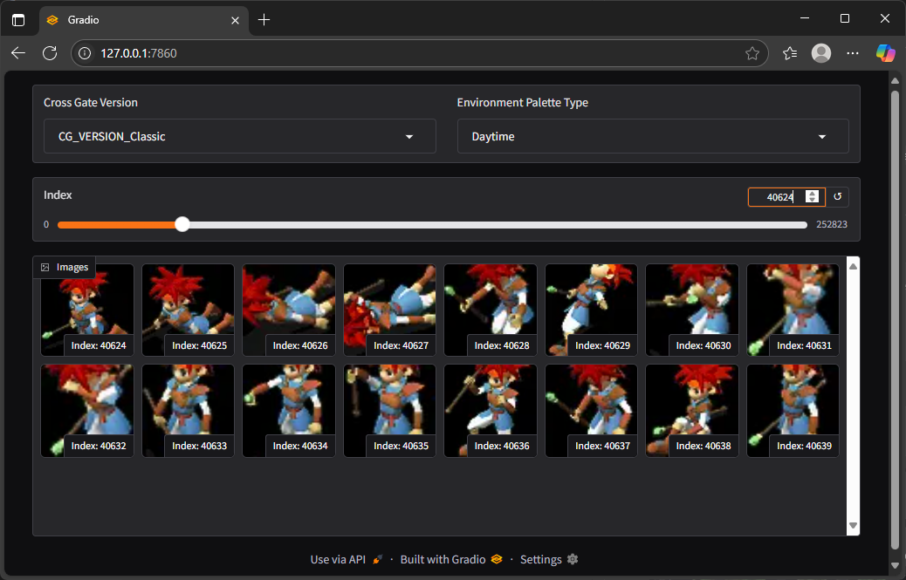

# CrossGate Graphics Data Viewer

A simple Gradio-based web application for previewing graphics data from the classic game Cross Gate using palettes and data provided by the cgl backend module.

This tool is part of the CrossGate-Legacy project and is intended for non-commercial use by fans to explore in-game graphics and palettes.

## Requirements

- Python 3.8+
- gradio >= 3.0 (recommended 5.38.0)
- Compiled cgl.pyd (built with CMake from CrossGate-Legacy project)

    > Make sure cgl module is in build/bin relative to this script.

## How to Run

Run the Python viewer:

    # From the repository root, using the Python environment matching cgl.pyd:
    $env:PYTHONPATH = (Resolve-Path build/dev/bin).Path
    python tools/GraphicsDataViewer/graphics_data_viewer.py

Open your browser:

    The app will launch at  http://127.0.0.1:7860/  by default.

## Current scope

This is a read-only image gallery, not a character animation viewer or map editor.
The existing entry uses `Session()` with the compiled default asset root
(currently `C:/CrossGate-Legacy`); it has no asset-root command-line option.
For the verified setup, current API ownership, known UI gaps and the next
character-preview step, see [Resource Preview 01](../../docs/resource-preview-audit.md).
